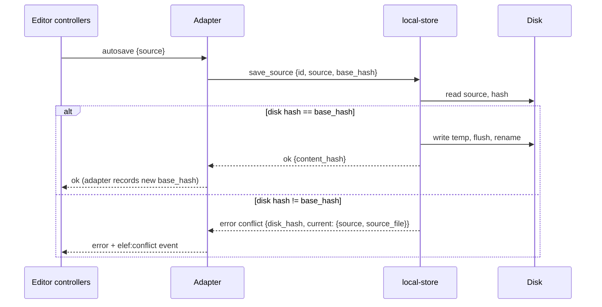

# ADR-008: Atomic writes, fingerprint checks, and a conflict UI

Reach for when: touching saves, conflict handling, the base-hash handshake, or quit/close guards.

- Status: Accepted
- Date: 2026-10-01
- Decider: Andres
- Amends: the "last-write-wins in v1" line in [ADR-001](001-folders-as-source-of-truth.md)

## Context

Auto-save is continuous, and other programs (editors, Dropbox, iCloud, Syncthing) can write the same files at any time. The product is user-owned files, so silent loss is the worst failure.

## Options considered

- Last-write-wins: simple, silently destroys edits. Rejected.
- File locking: not honored by editors or sync tools. Rejected as the primary mechanism.
- Optimistic concurrency with a fingerprint + conflict UI (chosen).
- CRDT/merge on every save: heavy and unnecessary for single-user, single-source-file works.

## Decision

1. **Atomic save.** Write a temp file in the same directory (dot-prefixed, so discovery ignores it), flush it to disk, rename over the target. A crash leaves the old or the new file, never a mix. Stale temp files from a crash are removed on the next open.
2. **Fingerprint.** (mtime, size, content hash) of the source file, recorded at every load and successful save. Hashing the source before each save is cheap.
3. **Check before write.** Before each save, re-evaluate the source-file rule and re-read/hash the selected source. If the selected filename or content differs from the recorded baseline, do not write — raise a `conflict`. Repeat this check immediately before replacement. The adapter supplies the last-known hash as `base_hash` (see the [transport adapter](../../../apps/desktop/frontend/src/transport-adapter.js)).
4. **Conflict UI:** keep mine / keep theirs / merge view. The buffer stays dirty and in memory until resolved. "Keep theirs" reloads from disk and leaves the discarded text on the session undo stack so it is recoverable in-session.
5. **Periodic check, fingerprint is truth.** While a work is open, the desktop periodically reads and hashes its source. No unsaved changes → silent reload; unsaved changes → conflict UI. Own writes are recognized by their resulting content hash.
6. **One writer per work.** Saves are serialized per work and coalesced (latest wins). Native Quit and window close use the same save/conflict guard. Pending work reads never advance the active save fingerprint; buffer installation and fingerprint activation happen synchronously. Deferred-read, deferred-graph, and delayed-replacement timing cases are covered by regression tests.
7. **Accepted v1 residual race:** the check and rename are not one atomic step, so an external write in that final synchronous window can still be lost. Re-check immediately before rename, measure the check-to-rename window in CI (p95 below 250 ms), and show a note in the editor recommending sync-tool version history. Do not claim the race is eliminated.

## Consequences

- The child-process kill matrix runs 50 times per point in Linux and macOS CI, confirming complete old-or-new source bytes and stale-temp cleanup. It does not simulate physical power loss; temp-file `sync_all` and parent-directory sync after rename are the durability path, but device-level power loss is not directly verified.
- Conflict handling is exercised by core save checks, save-flow unit tests, and the shared webview conflict scenario. CI measures the final fingerprint-check-to-rename interval against the 250 ms p95 budget. This narrows the accepted race; it does not eliminate an external write in that final interval.
- Safe on synced folders in the common cases; a sync tool producing a conflicted copy is handled by the source-file rule ([data-format.md](../data-format.md)).

## Revisit when

Saves are shown to miss the autosave budget, or the residual race is observed in practice.
